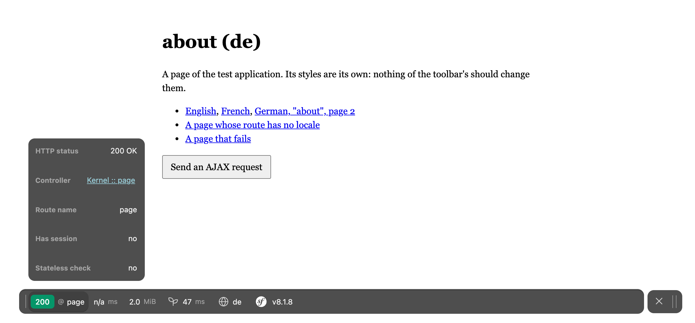
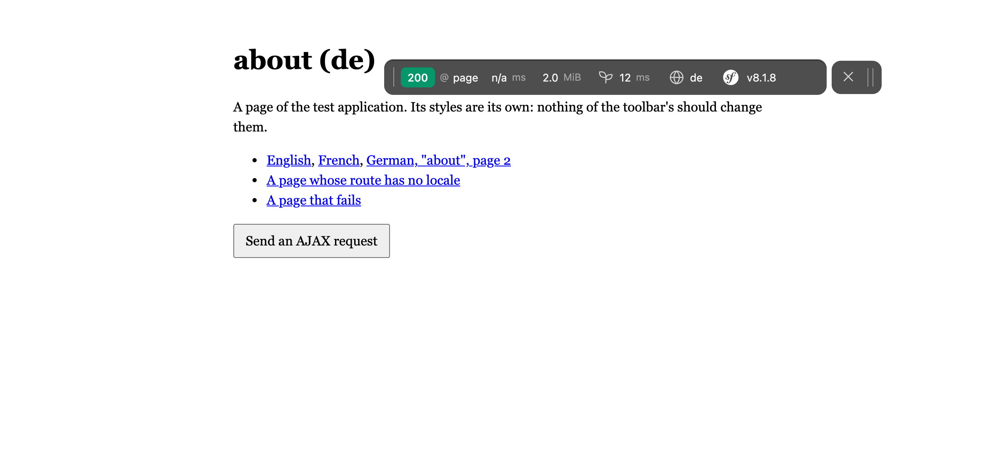
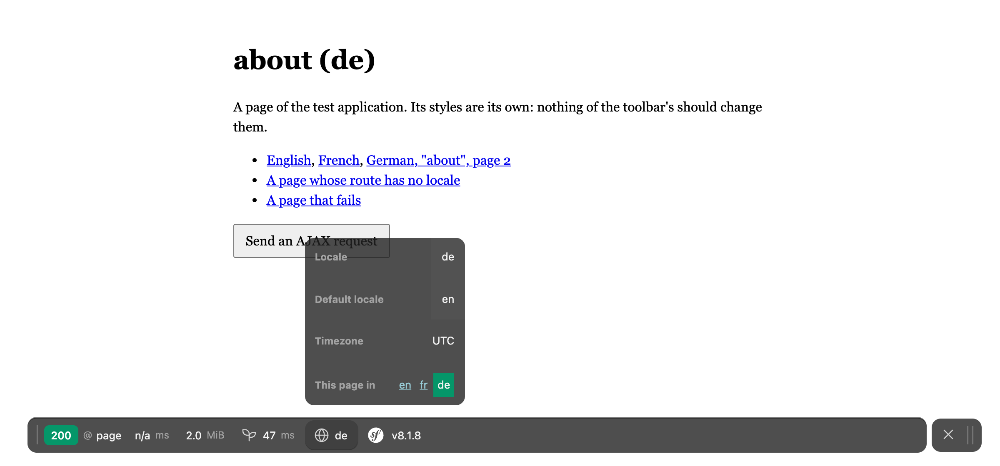

# Symfony Profiler Pack

A floating web debug toolbar for Symfony's profiler: move it out of the way, make it narrower, fold
it. With it, a locale panel and profiler pages that use the whole window.

It is a bundle, with code. Despite its name it is not a Composer "pack" (a package that only requires
others), and it is not the official [`symfony/profiler-pack`](https://github.com/symfony/profiler-pack),
which installs the profiler itself. This one adds to it.



## What it adds

- **A toolbar that floats.** A rounded bar over the page, in place of the strip across its bottom.
- **Move it.** Hold the handle at its right end and drag, with the mouse or a finger. Dragged into
  the upper half of the window, it opens its details downwards. On a touch screen the handle is the
  size of a fingertip.
- **Resize it.** Pull its left edge. Double-click that edge to fold it to its first block, again to
  unfold.
- **Send it aside.** Double-click the handle (double-tap it on a phone): the toolbar slides off to
  the left, its handle staying in view; do it again to bring it back.
- **It remembers.** Place and width are kept by the browser, from one page to the next.
- **A locale block.** The locale of the request, the default one, the timezone, and a link to the
  same page in each other enabled locale when its route has a `{_locale}`.
- **Wider profiler pages.** The profiler uses the window's whole width.
- **Two fixes.** No unstyled "Loading the web debug toolbar…" while the toolbar loads, and no script
  error from a toolbar block that has no details.

A plain click on the handle still opens and closes the toolbar, as it always did.





## Install

```bash
composer require --dev glitchr/symfony-profiler-pack
```

Enable it where the profiler is, in `config/bundles.php`:

```php
return [
    // ...
    Symfony\Bundle\WebProfilerBundle\WebProfilerBundle::class => ['dev' => true, 'test' => true],
    Glitchr\ProfilerPack\ProfilerPackBundle::class => ['dev' => true],
];
```

Symfony Flex adds the line by itself, for `dev` and `test` as for any `--dev` bundle; `dev` is enough.
There is nothing to configure.

Requires PHP 8.2, Symfony 7.4 or 8, and a browser that knows the CSS `:has()` selector (Chrome 105,
Safari 15.4, Firefox 121).

## Configuration

Everything is on by default. Each part has its switch, in `config/packages/profiler_pack.yaml`:

```yaml
when@dev:
    profiler_pack:
        floating: true          # the floating bar; false keeps Symfony's strip
        draggable: true         # moved by its handle
        resizable: true         # resized by its left edge
        minimizable: true       # the two double clicks
        fixes: true             # the loading flash and the script error
        hide_when: ~            # a CSS selector: while <html> or <body> matches it, the toolbar is hidden
        profiler_pages: true    # the profiler's pages on the whole width
        locale_panel: true      # the locale block and its profiler panel
        ajax_replace: ~         # true or false sets web_profiler.toolbar.ajax_replace; ~ leaves it alone
```

`draggable`, `resizable` and `minimizable` belong to the floating toolbar: with `floating: false` they
do nothing. With every switch off, the toolbar is byte for byte the one Symfony ships.

`hide_when` is for pages that animate their own changes: `hide_when: 'html.is-loading'` hides the
toolbar while a transition runs, so it is not the only thing left on screen.

The locale panel is a data collector named `locale`. If your application already has one by that name,
set `locale_panel: false`.

## How it works

The pack puts its templates in front of three of WebProfilerBundle's, and each of them starts by
including the original. Nothing of Symfony's is copied, so its changes keep coming through. The
details, and what is kept in the browser, are in [docs/how-it-works.md](docs/how-it-works.md).

## Tests

```bash
composer install
vendor/bin/phpunit
```

`tests/App` is a three-bundle application. To see the toolbar in a browser:

```bash
php -S localhost:8000 -t tests/App/public tests/App/public/index.php
# PACK=off php -S ... for the toolbar as Symfony ships it; PACK='{"floating":false}' for a configuration
```

## Licence

MIT. The toolbar's design was first written for [omnibase](https://github.com/glitchr-studio/omnibase).
